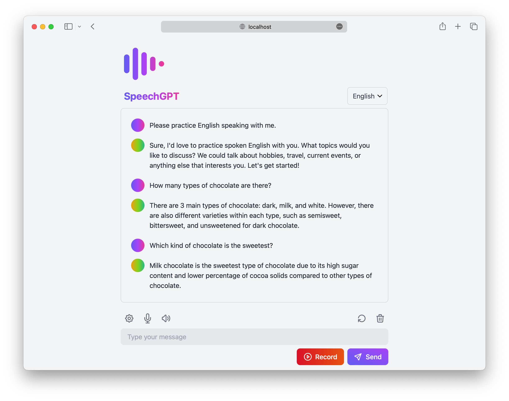
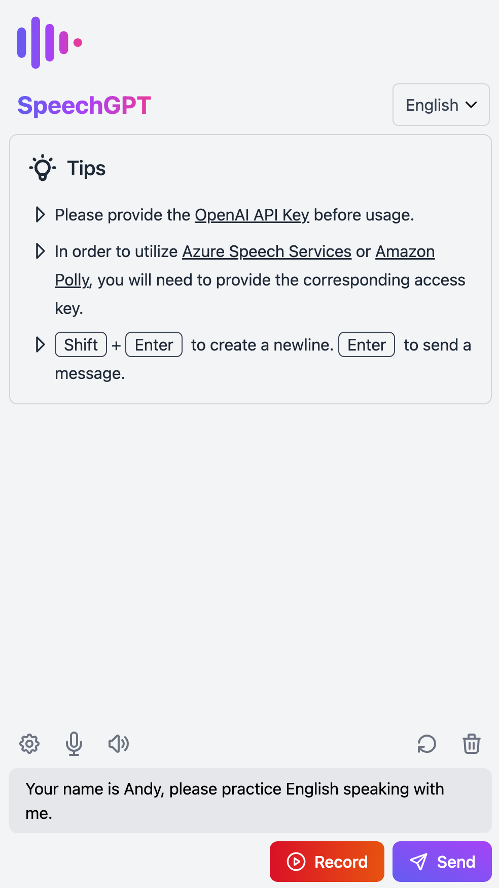
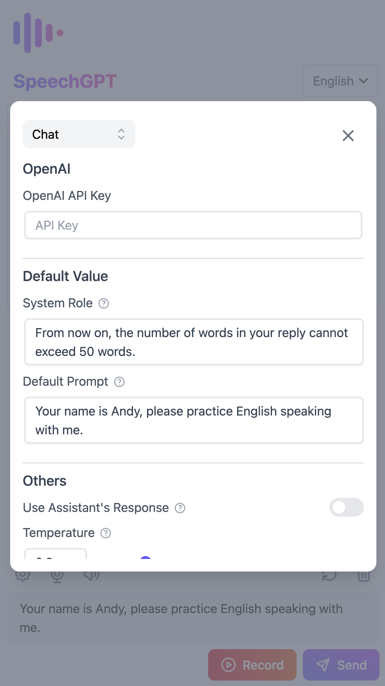
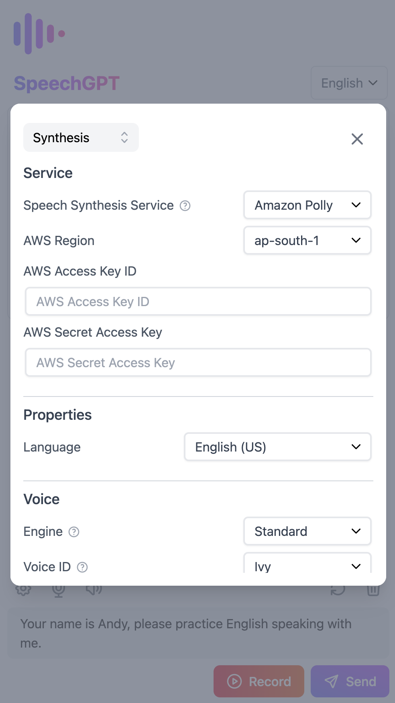

<p align="center">
  <a href="https://speechgpt.app"></a>
</p>

<p align="center">
  <a href="https://speechgpt.app/">Website</a> •
  <a href="https://github.com/hahahumble/speechgpt/blob/main/docs/README.zh.md">[中文]</a>
</p>

<p align="center">
  
</p>

## 🌟 Introduction
SpeechGPT is a web application that enables you to converse with ChatGPT.</br>
You can utilize this app to improve your language speaking skills or simply have fun chatting with ChatGPT.

## 🚀 Features
- 📖 **Open source and free**: Anyone can use, modify it without cost.
- 🔒 **Privacy First**: All data is stored locally.
- 📱 **Mobile friendly**: Designed to be accessible and usable on mobile devices.
- 📚 **Support for multiple languages**: Supports over 100 languages.
- 🤖 **Multiple LLM Providers**: Supports OpenAI and [MiniMax](https://www.minimaxi.com) as chat providers.
- 🎙 **Speech Recognition**: Includes both built-in speech recognition and integration with Azure Speech Services.
- 🔊 **Speech Synthesis**: Includes built-in speech synthesis, as well as integration with Amazon Polly, Azure Speech Services, and MiniMax TTS.

## 📸 Screenshots
<table>
  <tr>
    <td></td>
    <td></td>
    <td></td>
  </tr>
</table>

## 📖 Tutorial
1. Set the OpenAI API Key <br/>
    - Go to Settings and navigate to the Chat section.
    - Set the OpenAI API Key.
    - If you don't have an OpenAI API Key, follow this tutorial on [how to get an OpenAI API Key](https://www.windowscentral.com/software-apps/how-to-get-an-openai-api-key).
2. Use MiniMax as an alternative chat provider (optional)
    - Go to Settings and navigate to the Chat section.
    - Change the Chat Provider to MiniMax.
    - Set the MiniMax API Key.
    - Select a model (MiniMax-M2.7 or MiniMax-M2.7-highspeed).
    - You can get a MiniMax API Key from [MiniMax Platform](https://www.minimaxi.com).
3. Set up Azure Speech Services (optional)
    - Go to Settings and navigate to the Synthesis section.
    - Change the Speech Synthesis Service to Azure TTS.
    - Set the Azure Region and Azure Access Key.
4. Set up Amazon Polly (optional)
    - Go to Settings and navigate to the Synthesis section.
    - Change the Speech Synthesis Service to Amazon Polly.
    - Set the AWS Region, AWS Access Key ID, and Secret Access Key (the Access Key should have the AmazonPollyFullAccess policy).
    - If you don't have an AWS Access Key, follow this tutorial on [how to create an IAM user in AWS](https://www.techtarget.com/searchcloudcomputing/tutorial/Step-by-step-guide-on-how-to-create-an-IAM-user-in-AWS).
5. Set up MiniMax TTS (optional)
    - Go to Settings and navigate to the Synthesis section.
    - Change the Speech Synthesis Service to MiniMax TTS.
    - Set the MiniMax API Key (shared with chat if already configured).
    - Select a TTS model (speech-2.8-hd or speech-2.8-turbo) and a voice.

## 💻 Development Guide and Changelog
- For more information on setting up your development environment, please see our [Development Guide](./docs/developer-guide.md).
- To view the project's history of notable changes, please check the [Changelog](./CHANGELOG.md).

## 🚢 Deployment

### Deploying with Vercel
[](https://vercel.com/new/clone?repository-url=https%3A%2F%2Fgithub.com%2Fhahahumble%2Fspeechgpt&env=VITE_OPENAI_API_KEY,VITE_OPENAI_HOST,VITE_AWS_REGION,VITE_AWS_ACCESS_KEY_ID,VITE_AWS_ACCESS_KEY,VITE_AZURE_REGION,VITE_AZURE_KEY&envDescription=If%20you%20do%20not%20want%20to%20provide%20a%20value%2C%20use%20REPLACE_WITH_YOUR_OWN.&project-name=speechgpt&repository-name=speechgpt)

###  Deploying with Docker
1. Pull the Docker image:arm64.
```bash
docker pull hahahumble/speechgpt
```

2. Run the Docker container.
```bash
docker run -d -p 8080:8080 --name speechgpt hahahumble/speechgpt
```

3. Visit `http://localhost:8080/` to access the application.

### Building and running the Docker image
1. Build the Docker image.
```bash
docker build -t speechgpt:arm64 -f Dockerfile .
```

2. Run the Docker container.
```bash
docker run -d -p 8080:8080 --name=speechgpt speechgpt
```

3. Visit `http://localhost:8080/` to access the application.

## 📄 License
This project is licensed under the terms of the [MIT license](/LICENSE).
